# EPUB Reader Lab

같은 EPUB 파일 하나를 **두 가지 방식**으로 열어 비교하는 안드로이드 리더기 실험 프로젝트입니다.

| | 01 · Readium 리더 | 02 · 커스텀 리더 |
|---|---|---|
| 렌더링 | Readium kotlin-toolkit `EpubNavigatorFragment` (WebView) | 라이브러리 없이 ZIP · OPF · XHTML · CSS 직접 파싱 → Jetpack Compose |
| 페이지 나눔 | Readium(CSS columns) | `TextMeasurer`로 줄 단위 직접 계산 |
| 하이라이트 · 메모 | Readium `Decoration` (Highlight / Underline) | `AnnotatedString` 스팬 + `drawBehind` |

<p align="center">
  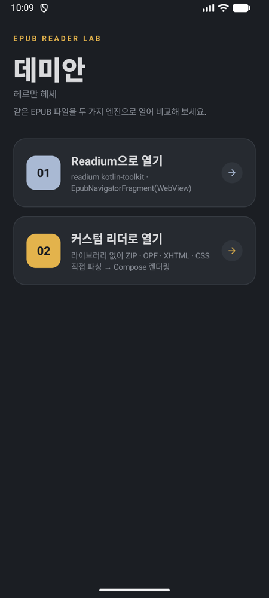
</p>

---

## 주요 기능

### 공통

- **책처럼 이어지는 본문**: 5개 장, 장마다 13~14개 문단이 페이지를 넘어 이어집니다.
- **다크 / 라이트 모드**: 상단 바의 해·달 아이콘으로 바꿉니다. 선택은 `SharedPreferences`에 저장되고 두 리더가 같은 값을 씁니다.
- **문단 꾹 누르기 → 문장 팝업**
  - 장면 속 인물과 대화하는 버튼(싱클레어 / 크로머)
  - **좋아요**: 문단에 하이라이트
  - **메모**: 메모 작성 시트 열기
  - 한 번 탭하면 팝업이 닫힙니다.
- **메모 시트**
  - 대상 문장을 인용 형태로 보여 줍니다.
  - 열리면 바로 키보드가 올라옵니다.
  - 최대 500자, 글자 수를 표시합니다.
  - 내용이 비었거나 바뀌지 않았으면 저장 버튼이 꺼집니다.
  - 기존 메모는 수정 / 삭제할 수 있습니다.
- **보기 설정 시트**(`Aa`)
  - 글자 크기, 줄 간격, 테마
  - 목차에서 장 바로 이동
  - 내 문장: 좋아요·메모한 문단 목록

### Readium 리더

| 본문 | 문장 팝업 | 라이트 모드 + 좋아요 | 메모 시트 |
|---|---|---|---|
|  | 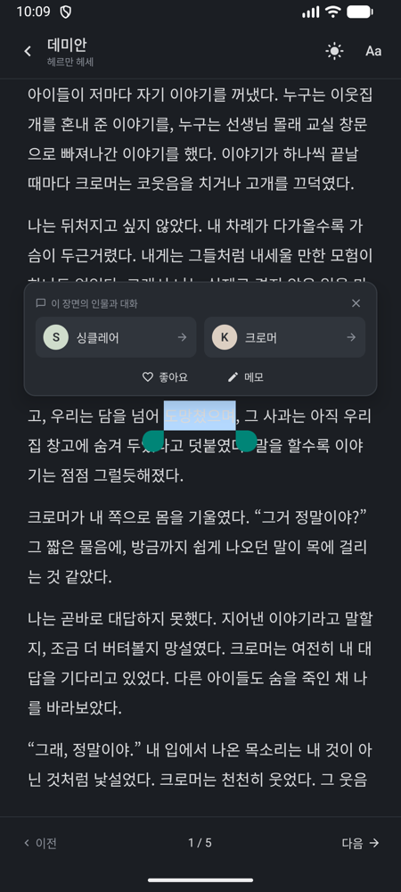 | 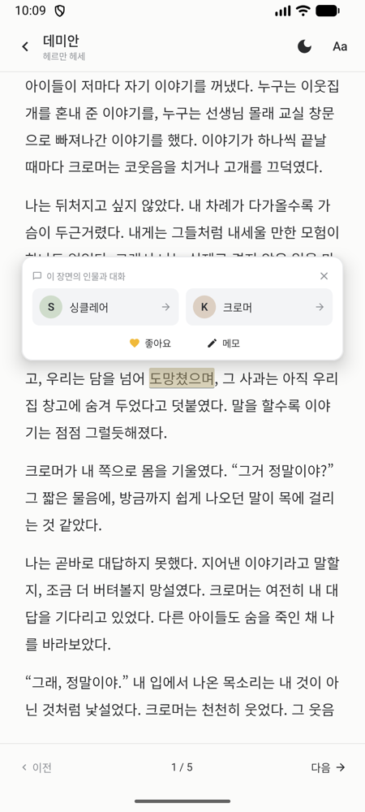 | 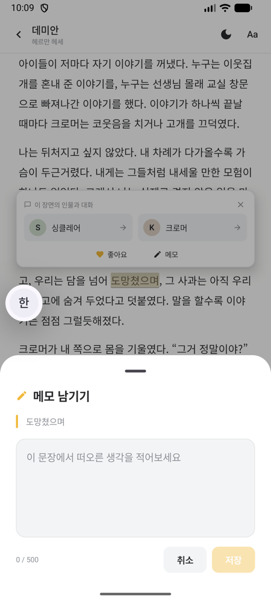 |

- `EpubNavigatorFragment`를 Compose의 `AndroidFragment`로 붙였습니다.
- 꾹 누른 위치의 문단은 WebView에 JavaScript를 실행해 찾습니다(`ParagraphHitTest.kt`). 결과로 CSS selector, 텍스트, 화면 사각형을 받아 `Locator`를 만듭니다.
- 좋아요는 `Decoration.Style.Highlight`, 메모는 `Decoration.Style.Underline`으로 표시합니다. 메모 데코레이션 id에는 `#memo` 접미사를 붙여 구분합니다.

### 커스텀 리더

| 장 첫 페이지(다크) | 라이트 모드 | 꾹 눌러 팝업 |
|---|---|---|
| 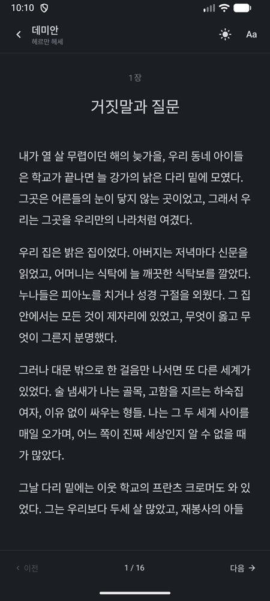 |  | 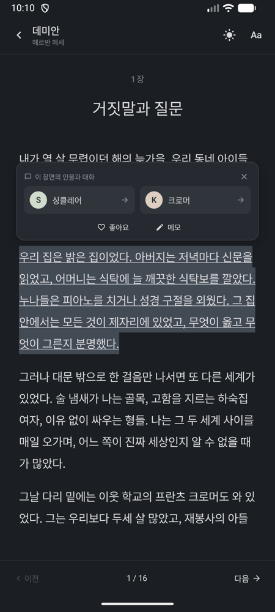 |

- EPUB의 CSS(장 라벨, 제목, 들여쓰기, 여백)를 직접 해석해서 원본 스타일 그대로 그립니다.
- **페이지 모드**: `HorizontalPager`, 스와이프 또는 이전/다음 버튼으로 넘깁니다(이 책은 16페이지).
- **스크롤 모드**: 설정에서 켜면 `LazyColumn`으로 이어서 읽습니다.
- 마지막으로 읽은 위치를 `(장, 블록, 글자 offset)`으로 저장합니다. 글자 크기를 바꿔 페이지가 다시 나뉘어도 같은 문장으로 돌아옵니다.

#### 메모는 이렇게 보입니다

| 메모 작성 | 저장 후 팝업 | 본문 표시 |
|---|---|---|
| 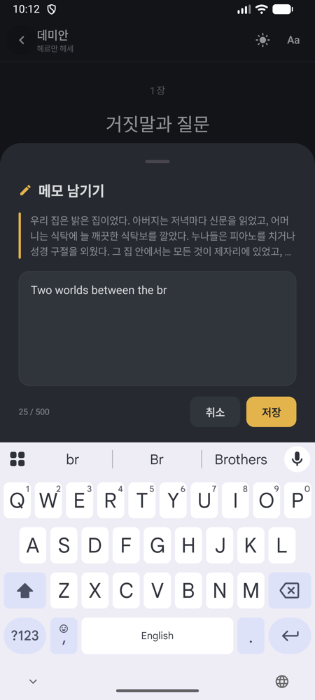 | 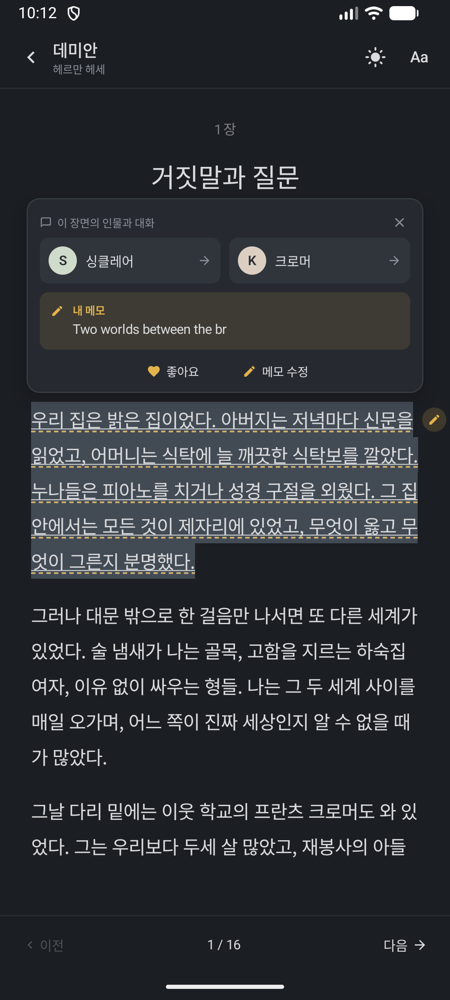 | 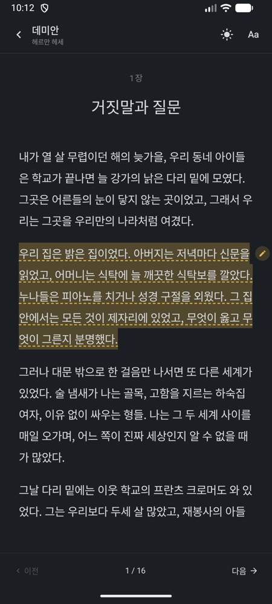 |

- 메모가 있는 문단은 줄마다 **강조색 점선 밑줄**을 긋습니다.
- 문단 첫 줄 오른쪽 여백에 **연필 배지**가 붙습니다. 배지를 누르면 팝업이 열립니다.
- 팝업에는 **"내 메모" 미리보기 카드**(최대 3줄)가 들어갑니다. 카드를 누르면 바로 수정 시트가 열리고, 액션 버튼도 "메모 수정"으로 바뀝니다.
- 좋아요 하이라이트와 메모 표시는 함께 쓸 수 있습니다.

#### 설정 시트

| 보기 설정 | 목차 | 내 문장 |
|---|---|---|
| 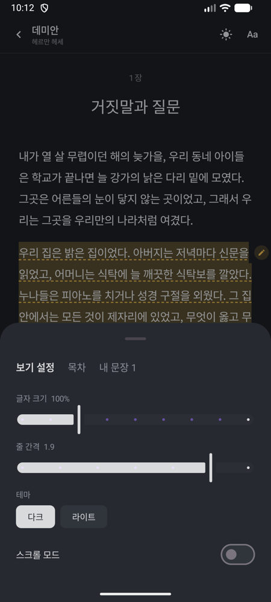 | 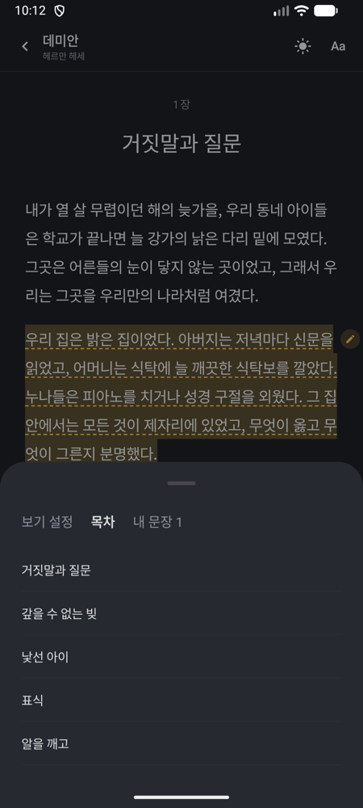 | 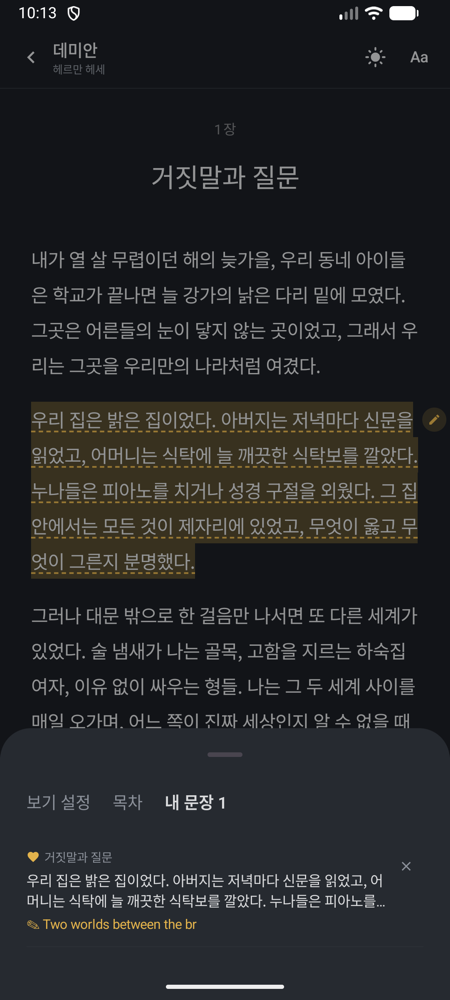 |

---

## 프로젝트 구조

```
app/src/main/java/com/example/epubtest/
├── MainActivity.kt                 # 시작 화면: 두 리더 중 하나 선택
│
├── reader/                         # Readium 리더 + 두 리더가 같이 쓰는 UI
│   ├── ReadiumReaderActivity.kt    # FragmentActivity, Navigator fragment factory 설치
│   ├── ReaderViewModel.kt          # Publication 열기, 설정, 어노테이션, 팝업 상태
│   ├── ReaderScreen.kt             # 상단/하단 바, 팝업, 설정 시트, 데코레이션 적용
│   ├── ParagraphHitTest.kt         # 좌표 → 문단 찾기 (WebView JS)
│   ├── MemoComponents.kt           # MemoSheet(작성/수정), MemoPreview(팝업 카드)
│   ├── ReaderModels.kt             # ReaderSettings, Annotation, ReaderPalette
│   ├── ReaderIcons.kt              # Material 아이콘 path (테마, 편집 등)
│   ├── ThemePrefs.kt               # 다크/라이트 저장 (두 리더 공유)
│   └── DummyBook.kt                # 샘플 EPUB(데미안 5장) 생성 → cacheDir
│
├── custom/                         # 라이브러리 없는 커스텀 리더
│   ├── CustomReaderActivity.kt     # Loading / Error / Ready 상태 처리
│   ├── CustomReaderViewModel.kt    # EPUB 파싱, 읽은 위치 저장, 좋아요·메모
│   ├── CustomReaderModels.kt       # 설정, ReadingPosition, CustomAnnotation
│   ├── CustomReaderScreen.kt       # PagedReader / ScrollReader / BlockView / 설정 시트
│   ├── Paginator.kt                # TextMeasurer로 줄 단위 페이지 나눔
│   └── epub/
│       ├── EpubParser.kt           # container.xml → OPF → nav/ncx → XHTML 블록
│       ├── XmlTree.kt              # XmlPullParser 기반 미니 DOM
│       └── Css.kt                  # 미니 CSS 엔진 (선택자, 명시도, UA 기본값, em 단위)
│
└── ui/theme/                       # Compose 테마
```

### 커스텀 리더 처리 흐름

```
DummyBook.writeEpub()  ─→  demian-dummy-v4.epub (cacheDir)
        │
        ▼
EpubParser
  ├─ ZipFile 로 압축 해제 없이 항목 읽기
  ├─ META-INF/container.xml  → OPF 경로
  ├─ OPF  → metadata(제목/저자) · manifest · spine
  ├─ nav.xhtml / toc.ncx  → 목차
  └─ 각 XHTML
       ├─ XmlTree (relaxed 모드, HTML 엔티티 치환)
       ├─ <link>/<style> CSS → StyleResolver 로 요소별 ComputedStyle
       └─ EpubBlock.Text / Image / Rule 로 변환 (인라인 굵게·기울임·밑줄·글자 크기 스팬 유지)
        │
        ▼
Paginator  (화면 크기 · 글자 크기 · 줄 간격 기준)
  └─ 블록을 줄 단위로 측정해 Page 리스트 생성 (문단이 페이지를 넘어가면 줄에서 자름)
        │
        ▼
CustomReaderScreen
  ├─ 페이지 모드: HorizontalPager
  ├─ 스크롤 모드: LazyColumn
  └─ BlockView: 하이라이트 스팬, 메모 점선, 배지, 꾹 누르기 처리
```

---

## 기술 스택

| 항목 | 버전 |
|---|---|
| Kotlin | 2.4.20 |
| Android Gradle Plugin | 9.2.1 |
| Jetpack Compose BOM | 2026.02.01 (Material 3) |
| Readium kotlin-toolkit | 3.4.0 (shared · streamer · navigator) |
| compileSdk / targetSdk / minSdk | 37 / 36 / 26 |

커스텀 리더는 Android 기본 API(`java.util.zip`, `android.util.Xml`)와 Compose만 사용합니다.

## 실행

```bash
git checkout dev
./gradlew :app:installDebug
```

Android Studio 번들 JDK를 쓰려면:

```bash
export JAVA_HOME="/Applications/Android Studio.app/Contents/jbr/Contents/Home"
```

## 알려진 제약 / 다음 작업

- 좋아요·메모는 메모리에만 저장되어 앱을 다시 켜면 사라집니다. 읽은 위치와 테마는 저장됩니다.
- 시작 화면은 아직 항상 다크 테마입니다.
- Readium 리더에는 메모 배지가 없고 밑줄로만 표시합니다.
- 커스텀 리더에서 아직 안 되는 것
  - 링크·각주 이동
  - EPUB 내장 폰트
  - 목록 글머리표, 표
  - 문단 일부만 범위 선택
- 샘플 본문은 『데미안』 1장을 바탕으로 새로 쓴 텍스트이며, 번역본이 아닙니다.
